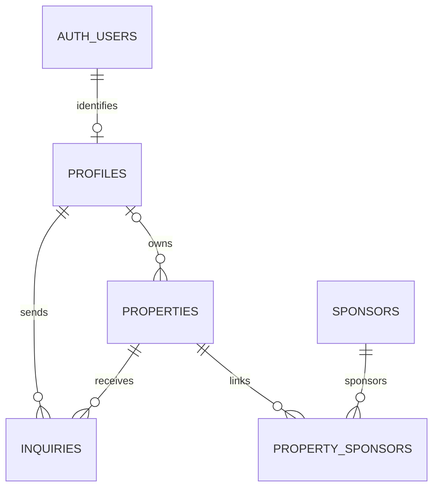

# Database schema and access plan

Relationships:
- auth.users -> profiles: one profile per authenticated user.
- profiles -> properties: one owner may have many listings.
- properties <-> sponsors: many-to-many through property_sponsors.
- profiles -> inquiries: one user may submit many inquiries.
- properties -> inquiries: one listing may receive many inquiries.

Public visitors read approved properties and active sponsors.
Authenticated owners create unapproved properties and may edit/delete
only their own unapproved properties. They cannot change approval or ownership.
Approved properties require administrative moderation before further edits.
Inquiries are visible to their sender and the listing owner.
Profile records are private to their owner.
Administrative service-role access is server-side only.

Deletion:
- Deleting an auth user cascades to their profile.
- A profile owning properties cannot be deleted until those properties
  are reassigned or removed (RESTRICT).
- Deleting a property cascades to its inquiries and sponsor links.
- Deleting a sponsor cascades only to sponsor links.

Verification status: migration prepared; live application and tests pending.
## Entity relationship diagram

Live migration and fictional seed applied successfully.
Anonymous, owner, and other-user API tests passed.
Administrator SQL role test passed and rolled back.
Clean-schema rebuild verification is tracked separately.